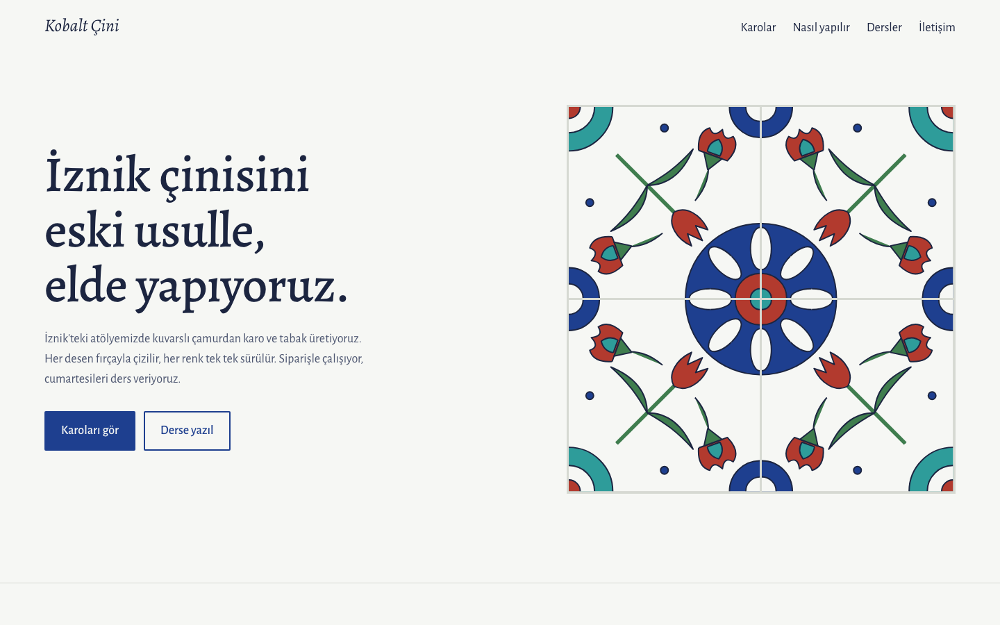
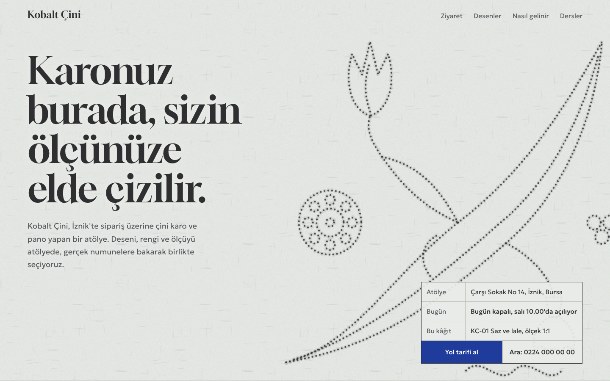
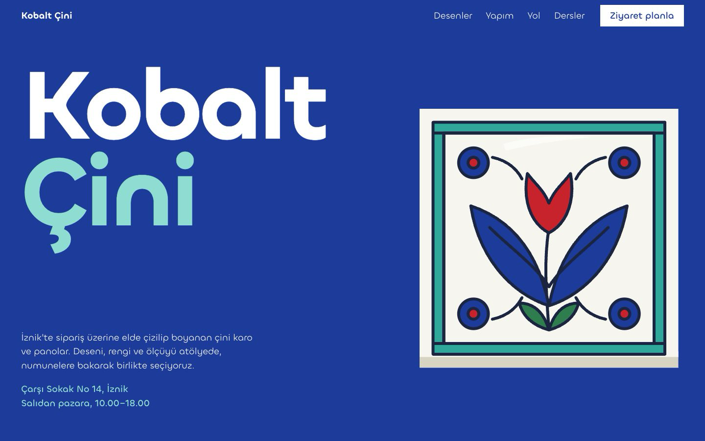
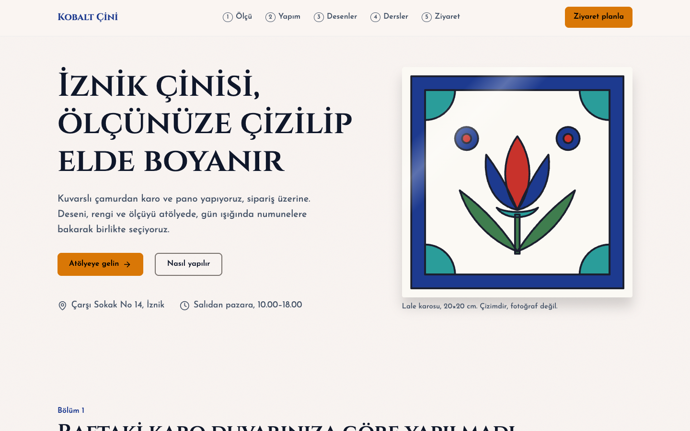

# Tasarım Web: yapay zekâ tasarım skill'lerini karşılaştırma

Bu repo bir deney. Soru şu: Claude Code'a bir web sitesi yaptırırken kullandığın tasarım skill'i sonucu ne kadar değiştirir?

Bunu ölçmek için **konu hep aynı tutuluyor**, sadece skill değişiyor. Böylece iki site arasındaki fark konudan değil, doğrudan skill'den geliyor.

**Ortak konu:** Kobalt Çini, İznik'te el yapımı çini karo üreten ve cumartesi dersleri veren **hayalî** bir atölye. Adres, telefon, fiyatlar ve tarihler örnektir.

## Denemeler

| # | Skill | Klasör | Durum |
|---|---|---|---|
| 1 | [frontend-design](https://github.com/anthropics/skills/tree/main/skills/frontend-design) (Anthropic, resmi) | [`1-frontend-design/`](1-frontend-design/) | Bitti |
| 2 | [Impeccable](https://github.com/pbakaus/impeccable) (Paul Bakaus) | [`2-impeccable/`](2-impeccable/) | Bitti |
| 3 | [Taste Skill](https://github.com/Leonxlnx/taste-skill) (Leonxlnx) | [`3-taste/`](3-taste/) | Bitti |
| 4 | [UI/UX Pro Max](https://github.com/nextlevelbuilder/ui-ux-pro-max-skill) (NextLevelBuilder) | [`4-ui-ux-pro-max/`](4-ui-ux-pro-max/) | Bitti |
| 5 | [Emil Kowalski Skills](https://github.com/emilkowalski/skills) | | Sırada |

Bu beş skill, 2026'da "en iyi UI skill'leri" listelerinde en sık geçenler arasından seçildi. GitHub yıldızlarına ve güncelliğine de bakıldı.

Bütün siteler sade HTML/CSS ile yazıldı, derleme adımı yok. Teknoloji sabit kalsın diye böyle yapıldı. İki deneme arasındaki tek değişken skill olmalı.

## 1. frontend-design



**Skill nasıl çalışıyor:** Kısa bir talimat dosyası. Claude'u bir tasarım stüdyosunun sanat yönetmeni gibi davranmaya zorluyor:

- Kodlamadan önce renk, yazı tipi, yerleşim ve ilkeleri içeren bir plan yazılır.
- Plan, "yapay zekâ işi" görünen kalıplarla karşılaştırılır. Bu kalıpların başlıcaları: krem zemin üstüne serif başlık, mor gradyan, her başlığın üstünde büyük harfli küçük etiket, birbirinin aynı yuvarlak köşeli kartlar.
- Cesaret tek bir öğeye harcanır, geri kalan her şey sakin tutulur.
- Bitince ekran görüntüsü alınır ve tasarım eleştirilir.

**Ortaya çıkan:** Klasik bir İznik çini sitesi.

- Kobalt, firuze ve mercan kırmızısı renkler.
- Alegreya yazı tipi.
- Sayfa açılırken deseninin önce çizgileri çizilen, sonra boyanan bir çini pano. Bu, gerçek çini yapımındaki tahrir ve boyama sırasını taklit ediyor.
- Karolar, yapım aşamaları ve ders tablosu.

**Süreç:** Hızlı. Bir plan, bir kodlama, bir ekran görüntüsü turu.

## 2. Impeccable



**Skill nasıl çalışıyor:** frontend-design'ın üzerine kurulmuş, çok daha kapsamlı ve kurallı bir sistem:

1. **Ürün dosyası.** Önce kullanıcıya ürünle ilgili sorular sorulur: kim gelecek, başarı nedir, hangi teknoloji kullanılacak. Cevaplar [`PRODUCT.md`](PRODUCT.md) dosyasına yazılır. Bu projede cevaplar şöyleydi: ziyaretçi karo sipariş edenler, başarı atölyeyi gelip görmeleri.
2. **Yön araştırması.** Kategorinin herkesin yaptığı sayfası yasak. Bu konuda o sayfa, mavi çini fotoğrafının yanında başlık. Bunun yerine ziyaretçinin dünyasından yedi aday "görsel dünya" çıkarılır ve aralarından biri seçilir.
3. **Yön sözleşmesi.** Seçilen yön, kodlamadan önce [`.impeccable/briefs/2-impeccable.md`](.impeccable/briefs/2-impeccable.md) dosyasına sözleşme olarak yazılır.
4. **Kalite tabanı.** Yasak kalıplar listesi var: başlık üstü etiket yasak, gradyan yazı yasak, rastgele yazı tipi yasak. Kontrast, odak halkası ve seçili metin rengi gibi tarayıcı ayrıntıları da kontrol edilir.
5. **Bağımsız inceleme.** Siteyi yapan değil, konuşmayı hiç görmemiş ayrı bir ajan inceler. İnceleyici "düzelt" derse düzeltilir ve aynı inceleyiciye geri gönderilir. Gözetimsiz çalışmada en fazla iki tur yapılır.
6. **Tasarım sistemi kaydı.** Son olarak tasarım sistemi [`DESIGN.md`](DESIGN.md) ve [`.impeccable/design.json`](.impeccable/design.json) dosyalarına yazılır. Bu da ayrı bir ajanın işi.

**Ortaya çıkan:** Sayfanın kendisi bir *silkme kâğıdı*, yani çini deseninin karoya aktarıldığı, iğneyle delinmiş kâğıt.

- Açılışta kömür tozu deliklerden geçer ve lale-saz deseni belirir. Fare gezdikçe toz eklenir.
- Çizim kâğıtlarının köşesindeki bilgi kutusu adres, "bugün açık mı" bilgisi (İstanbul saatine göre canlı) ve yol tarifi düğmesi taşır.
- Desen kartlarında boyalı karonun üstünde yarısı kaldırılmış delikli kâğıt durur. Tıklayınca kâğıt kalkar.
- Her bölümde kâğıt köşe işaretleri ve el yazısı kurşun kalem notları var.
- Kobalt yalnızca "boyanmış" yerlerde kullanılır: ana düğme, bağlantılar ve sırlı karo gibi duran alt bölüm.

**Süreç:** Uzun ve kurallı. İki soru turu, sözleşme, iki düzeltme turu ve tasarım sistemi kaydı.

**Dürüst notlar:**

- Impeccable'ın kendi yardımcı programı internetten bir dosya indirip çalıştırmak istedi, güvenlik ayarı buna izin vermedi. Skill'in tanımladığı yedek yol kullanıldı. Bunun sonuçları:
  - Konsept zarı atılmadı. Yön listesi elle sıralandı ve en üstteki seçildi.
  - Hazır kalıp tarayıcısı çalışmadı. Onun yerine bağımsız inceleyici kullanıldı.
- İnceleyicinin iki turdan sonra "kısmen" bıraktığı iki madde var:
  - Kâğıt lifi dokusu rastgele değil, hafif bir "+" ızgarası gibi görünüyor.
  - Delikli desen giriş bölümünden sonra tekrar etmiyor.

## 3. Taste Skill



**Skill nasıl çalışıyor:** Diğer ikisinden farklı olarak işin büyük kısmını kendi script'leri yapıyor. Yazarı skill'i 247 ödüllü siteyi inceleyerek kurduğunu söylüyor.

1. **Envanter.** Önce sadece bu müşteriye ait 8–12 şey listelenir: adı, sokağı, rakamları, malzemesi, ritüelleri. Fikir bu listeden çıkmak zorunda.
2. **Argüman.** Sayfa önce iddialar listesi olarak yazılır, her iddianın bir kanıtı vardır. İddiası olmayan bölüm silinir.
3. **Yön çekme.** `draw.mjs` script'i 20 hazır yönden üçünü rastgele çeker, biri seçilir. Script sonra o yönün yazı tipini, paletini, açılış ekranını ve her bölümün yerleşimini de dağıtır. Bu denemede çıkan yön "renk bölümleri" (seed 1283138793): her bölüm tam ekran, düz bir renk alanı.
4. **Fikir cümlesi.** "Bu sayfada [konuya ait bir şey], [yönün istediği araca] dönüşür." Cümleye en yakın rakip konulur. Cümle onun için de geçerliyse fikir kategoriye aittir ve reddedilir.
5. **Canlı şey.** Ziyaretçinin yapabileceği tek bir şey zorunlu.
6. **Gerçek görsel.** `assets.mjs` açık arşivlerde (Met, Art Institute of Chicago, Wikimedia, Openverse) ticari kullanıma izin veren görselleri arar, indirir ve kaynak bilgisini kaydeder. Sayfada en az dört gerçek resim olmak zorunda. Çizimler bu sayıya dahil değil.
7. **Ölçüm.** `inspect.mjs` Chrome'u açıp sayfayı 1440, 768 ve 390 piksel genişlikte ölçer. Başlık satır sayısı, yazı boyları, kontrast, kenar boşlukları, boş alanlar ve yasak kalıplar kontrol edilir. Yasaklar diğer skill'lerden de sert: gradyan, gölge, ince çizgi, büyük harfli küçük etiket ve 01/02 numaralandırma kullanılamaz. Krem zemin, kiremit rengi ve mor da yasak.
8. **Bakış turu.** Ekran görüntüleri jüri puanlamasıyla eleştirilir, en büyük üç sorun düzeltilir. En fazla üç tur yapılır.

**Ortaya çıkan:** Sayfanın renk sırası bir İznik karosunun boyanma sırası.

- Kobalt açılış, beyaz gövde, gece mavisi galeri, firuze yapım, mercan yol, beyaz dersler, firuze iletişim ve gece mavisi kapanış. Üst çubuk altındaki bölümün rengini alıyor.
- Atölyenin adı boyanın adı, bu yüzden sayfa kobaltla açılıyor.
- **Canlı şey:** Yapım bölümünde beş aşamalı bir akordeon var. Her aşama açıldıkça aynı karo o günkü hâlini alıyor: çıplak gövde, tahrir çizgileri, boya, sırın süt beyazı altında soluk renkler, fırından çıkmış parlak karo.
- Galeride Met ve Chicago müzelerinden sekiz gerçek 16. yüzyıl İznik karosu var. Her birinin altında müze etiketi gibi renkli bir şerit duruyor. Ek olarak İznik Gölü fotoğrafı ve gerçek bir karo fırınının içinden döngülü video kullanıldı.
- Yol bölümü dev harflerle bir afiş: yenikapı, yalova, iznik, çarşı sk. 14.
- Ders ücretleri boyları basamak basamak artan renk bloklarıyla gösteriliyor.

**Süreç:** En uzun ve en ölçülü deneme. Ölçüm aracı üç kez FAIL verdi:

- Mercan kırmızısı (#c23b2a) yasak "kiremit" aralığına düştü. Daha saf bir İznik kırmızısına (#c8232c) çekildi.
- Fiyat notu tablette bir başlığın üstüne denk geldi ve etiket gibi göründü.
- Telefonda yol satırlarının küçük bilgisi bir sonraki durağın etiketi gibi okundu.

Ardından üç bakış turu yapıldı. Son puan: tasarım 8, kullanılabilirlik 8, yaratıcılık 7,5, içerik 8, toplam 7,9. Notlar ve turlar [`.taste-skill/notes.md`](.taste-skill/notes.md) dosyasında.

**Dürüst notlar:**

- Yazarın ilk paleti (turuncu, adaçayı, asit sarı) konuyla çelişiyordu. Skill böyle durumlarda oranları koruyup renkleri konudan almayı söylüyor, öyle yapıldı.
- Açılış ekranının yerleşimi önerilen tasarımdan ayrıldı. Önerilen tasarımda görsel yoktu. Ölçüm sol altta büyük bir boşluk bulunca bitmiş karo çizimi açılışa eklendi.
- Kalan tek uyarı ölçüm aracının kendi hatası. Kayan görsel şeridinin ekran dışındaki kopyalarını "bölümün ortası boş" diye sayıyor. Ölçülen 2156 piksellik boşluk, 1440 piksellik ekrandan bile geniş.
- Müze karoları atölyenin ürünü değil. Sayfada müze adlarıyla gösteriliyorlar ve kaynakları altbilgide. Desen kodları (KC-01 vb.) örnek.
- Açılıştaki karo bir çizim. Yanındaki gerçek müze karolarının yanında basit kalıyor.

## 4. UI/UX Pro Max



**Skill nasıl çalışıyor:** Diğer üçü Claude'a nasıl düşüneceğini anlatıyor. Bu ise bir veritabanı. Yanında gelen Python script'i (yalnız standart kütüphane, internete çıkmıyor) CSV tablolarında arama yapıyor: 192 ürün kategorisi, 79 stil, 192 palet, 74 yazı tipi eşi, 119 UX kuralı. Süreç şöyle:

1. **Analiz.** İstekten ürün türü, kitle, stil sözcükleri ve teknoloji çıkarılır. Teknoloji tahmin edilmez, projeden okunur.
2. **Tasarım sistemi.** `search.py "<sorgu>" --design-system` ürün kategorisini bulur. Sonra o kategorinin kurallarıyla stili, paleti, yazı tiplerini, sayfa kalıbını, efektleri ve yasakları tek seferde verir. Üç ayar düğmesi var: çeşitlilik, hareket ve yoğunluk. Bu denemede 6, 4 ve 3 seçildi.
3. **Doğrulama.** Sonucun kategorisi kontrol edilir. Uymuyorsa sorgu bir kez daraltılıp tekrarlanır. Eşleşme yoksa uydurulmaz, açıkça söylenir.
4. **Kayıt.** `--persist` sistemi [`design-system/kobalt-cini/MASTER.md`](design-system/kobalt-cini/MASTER.md) dosyasına yazar. Sayfaya özel sapmalar ayrı bir dosyaya gider: [`pages/anasayfa.md`](design-system/kobalt-cini/pages/anasayfa.md). Bu dosya Master'ı ezer.
5. **Ek aramalar.** Renk, yazı tipi, stil, sayfa kalıbı ve UX için tek konulu, 2–5 sözcüklük aramalar yapılır.
6. **Teslim öncesi liste.** Kontrast 4.5:1, görünür odak, 44 piksel dokunma alanı, emoji yerine SVG ikon, `prefers-reduced-motion`, 375/768/1024/1440 genişlikler.

**Arama günlüğü:**

- İlk sorgu ("handmade ceramic tile atelier artisan") kategori bulamadı. Genel bir sonuç geldi: SaaS mavisi ve turuncu.
- Veritabanında zanaat ya da atölye kategorisi yok. En yakını *Home Decoration & Interior Design* çıktı. Kitle ev sahibi ve mimar olduğu için bu seçildi.
- O kategorinin sistemi:
  - Stil: İsviçre minimalizmi.
  - Kalıp: "kaydırdıkça anlatı". Her bölüm bir bölüm, her bölüm sonunda küçük çağrı, en sonda büyük çağrı.
  - Palet: sıcak gri ve kehribar.
  - Yazı tipleri: Cinzel ve Josefin Sans.
- Stil aramasında *Nature Distilled* çıktı ("zanaat ürünleri, ev dekoru için"). Yüzeydeki hafif doku buradan geliyor.
- Kobalt rengi için palet araması eşleşme bulamadı. Tüm sorgular ve kararlar sayfa dosyasında tablo olarak duruyor.

**Ortaya çıkan:** Dört deneme içinde en derli toplu ve en alışıldık sayfa.

- Bölümler numaralı: 1 Ölçü, 2 Yapım, 3 Desenler, 4 Dersler, 5 Ziyaret. Üst çubukta hangi bölümde olduğun işaretleniyor, altında ince bir ilerleme çizgisi var.
- **Yapım bölümü:** Solda yapışkan bir karo duruyor. Sağdaki beş adım (gövde, astar ve tahrir, boya, sır, fırın) ekrana girdikçe karo o adımdaki hâline geçiyor: kurumuş çamur, yalnız çizgiler, boyalı, sırın altında süt beyazı soluk, fırından çıkmış parlak.
- Altı desen kartı kodla çizildi: lale, çintemani, bulut, hatayi, saz, rumi. Kartlar kademeli beliriyor. Skill bunun için GSAP kodu verdi, teknoloji aynı kalsın diye aynısı CSS ile yazıldı.
- Ders tablosu var. Kapanış kobalt bir ziyaret bölümü: adres, saat, yol, telefon ve e-posta Lucide ikonlarıyla.

**Süreç:** Kısa ve mekanik. Bir analiz, yaklaşık on arama, iki kayıt dosyası, kodlama ve listenin kontrolü. Skill'in kendi ekran görüntüsü ya da eleştiri adımı yok.

**Dürüst notlar:**

- Veritabanı yaklaşımı konu kategorideyse güçlü, değilse zayıf. "İznik çini atölyesi" hiçbir satıra oturmadı. Gelen sistem bir dekorasyon uygulaması içindi. Bu yüzden İsviçre stili "kurumsal uygulama, SaaS" için önerilen bir stil, Cinzel ise "emlak, lüks" havasında bir yazı tipi.
- Yalnızca ana renk değiştirildi. Sıcak gri yerine kobalt kondu, çünkü atölyenin adı o boya. Skill sonuçları "kural değil öneri" sayıyor ve depo kurallarını üstün tutuyor, sapma sayfa dosyasına yazıldı. Kehribar düğme rengi İznik paletinde yok ama skill'in seçimi olduğu için bırakıldı.
- Tasarım sistemi ilk sorguda kötü bir sonuç verdiği hâlde verdiği şeyi düzgün gerekçelendiriyor. Asıl fark yaratan, sonucu doğrulama ve bir kez yeniden deneme kuralı oldu.
- Sade HTML/CSS için hazır kılavuz yok. En yakını html-tailwind ama Tailwind kullanılmıyor. Skill "teknolojiyi tahmin etme" dediği için bu adım atlandı.
- Teslim öncesi listesinin uzun hâli (`pro-rules.md`) mobil uygulamalar için. Web için skill'in yönlendirdiği `quick-reference.md` §1–§3 kullanıldı.
- Skill'de ölçüm aracı yok. Listeyi kontrol etmek için Chrome'u açan küçük bir script yazıldı (repoda değil). Script dört genişlikte metin kontrastına, yatay taşmaya ve 44 pikselden küçük hedeflere baktı.
  - Kontrast ve taşma temiz çıktı.
  - Marka bağlantısı 44 pikselin altındaydı, düzeltildi.
  - Telefonda ders tablosunda tarih ve ücretler kırılıyordu, düzeltildi.
  - Elle geçişte bir hata daha bulundu: kobalt ziyaret bölümünde odak halkası da kobalttı, yani görünmüyordu.
- Skill'in script'leri `python3 -I` ile çalışmıyor, çünkü kendi modüllerini script klasöründen yüklüyor. Kod okunup yalnız standart kütüphane kullandığı görüldükten sonra normal çalıştırıldı.
- Repoda ana skill'in yanında altı yan skill daha var (marka, slayt, afiş gibi). Bu iş için yalnız `ui-ux-pro-max` kuruldu.

## Karşılaştırma

| | frontend-design | Impeccable | Taste Skill | UI/UX Pro Max |
|---|---|---|---|---|
| Kodlamadan önce | Kısa bir plan | Sorular, ürün dosyası, yedi aday yön, sözleşme | Envanter, argüman, script'in çektiği üç yön, fikir cümlesi | Veritabanı araması, tasarım sistemi dosyası, sayfa sapmaları |
| Fikir | Konuya uygun ama beklenen | Konunun içinden çıkan, alışılmadık | Konudan çıkan ama yönün kalıbına oturan | Kategorinin kalıbı (kaydırdıkça anlatı), içeriği konuya uyarlanmış |
| Görseller | Kodla çizim | Kodla çizim | Gerçek müze ve arşiv görselleri, video, kaynaklı | Kodla çizim, Lucide ikonlar |
| Kontrol | Kendi ekran görüntüsüne bakıp düzeltme | Bağımsız inceleyici, iki düzeltme turu | Tarayıcıda ölçüm (FAIL/WARN), jüri puanlı üç bakış turu | Teslim öncesi kural listesi (araç yok, elle ve yardımcı script'le) |
| Çıktılar | Site | Site, PRODUCT.md, DESIGN.md, design.json | Site, notlar, yön dosyası, ölçüm görüntüleri | Site, MASTER.md, sayfa sapma dosyası |
| Süre ve maliyet | Düşük | Yüksek | En yüksek | Düşük–orta |

## Çalıştırma

Derleme yok. Dosyayı tarayıcıda açman yeterli:

```sh
open index.html
```

`index.html` denemelere bağlantı veren karşılaştırma sayfası.

## Skill'leri kurma

Skill dosyaları bu repoya konmadı, çünkü başkalarına ait ve kendi lisansları var. Denemeleri tekrarlamak için:

```sh
# frontend-design (Claude Code içinde)
/plugin install frontend-design@claude-plugins-official

# Impeccable
npx impeccable install

# Taste Skill (Node 22+ ve Chrome gerekir; görsel aramak için internet)
npx skills add https://github.com/Leonxlnx/taste-skill --skill "design-taste-frontend"

# UI/UX Pro Max (Python 3 gerekir, internet gerekmez)
npx ui-ux-pro-max-cli init --ai claude
# ya da: repodaki .claude/skills/ui-ux-pro-max klasörünü projenin .claude/skills/ altına kopyala
```

## Klasörler

```
index.html              karşılaştırma sayfası
1-frontend-design/      1. deneme
2-impeccable/           2. deneme (silkme.js: delik ve toz efekti, açık/kapalı durumu)
3-taste/                3. deneme (karo.js: aşama akordeonu, renk değiştiren üst çubuk; gorseller/: müze ve arşiv görselleri, credits.json)
4-ui-ux-pro-max/        4. deneme (sayfa.js: ilerleme çubuğu, etkin bölüm, adım adım yapılan karo)
PRODUCT.md              Impeccable'ın ürün dosyası
DESIGN.md               Impeccable'ın tasarım sistemi kaydı
.impeccable/            yön sözleşmesi, inceleme ekran görüntüleri, design.json
.taste-skill/           notlar ve eleştiri turları, çekilen yön (direction.json), ölçüm ekran görüntüleri
design-system/          UI/UX Pro Max'in tasarım sistemi (MASTER.md) ve sayfa sapmaları (pages/anasayfa.md)
ekranlar/               README görselleri
```
